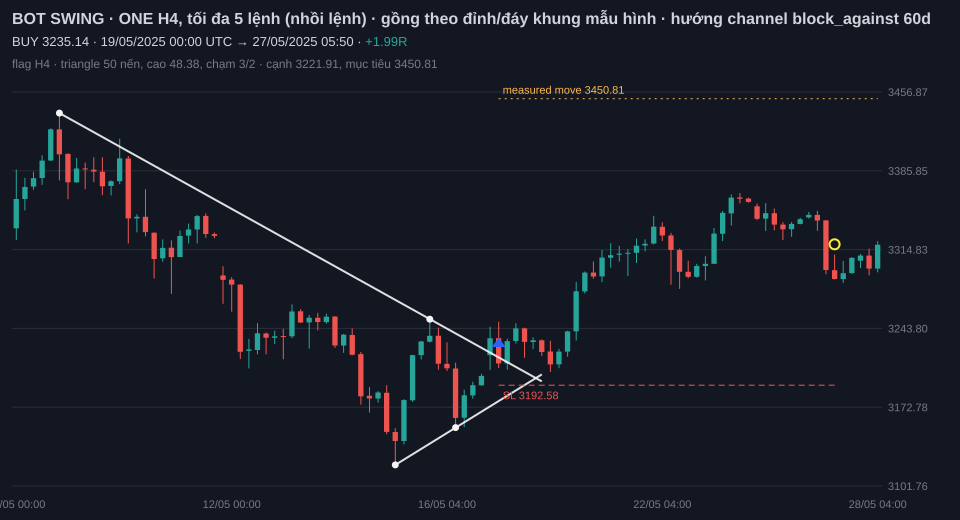
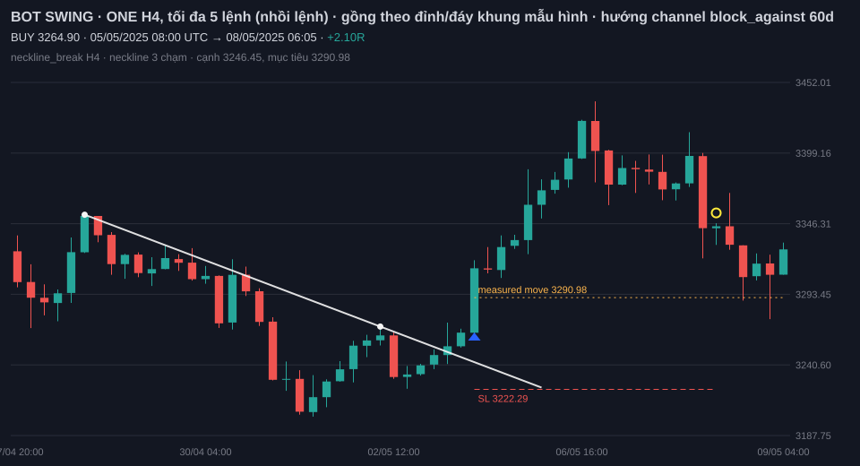
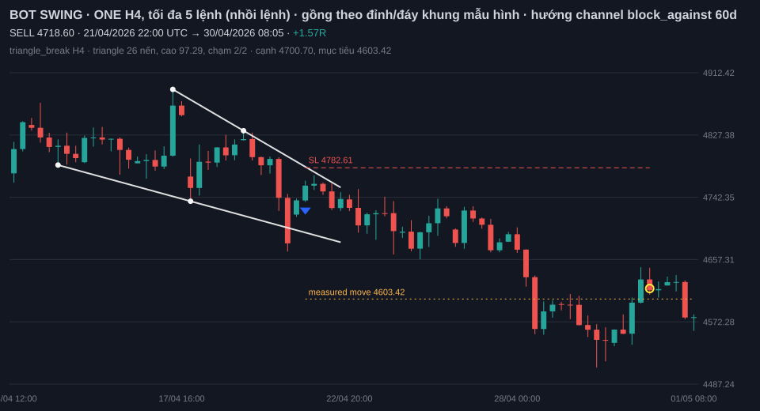
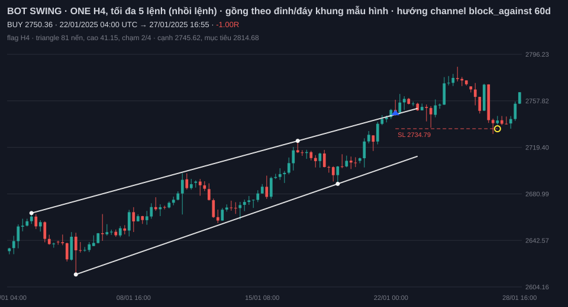

# Phương pháp ONE — Phá cấu trúc theo xu hướng, gồng theo đỉnh/đáy

ONE là phương pháp duy nhất bot dùng để vào lệnh. Nó được tổng hợp từ toàn bộ kiến thức đã nạp:
- XAU Playbook: lọc xu hướng EMA50/EMA200.
- Mẫu hình trendline từ ảnh của bạn: cờ, tam giác, kênh, neckline.
- Cách vẽ của MJ Capital: trendline là một vùng; cờ xuất hiện sau một cú chạy mạnh.
- Nhận định hướng của channel MJ Capital: dùng để chặn lệnh ngược hướng.

Mọi quy tắc đều cố định và lặp lại được. Backtest và bot live chạy **cùng một đoạn code** (`playbook/`).

## 1. Điều kiện vào lệnh (đủ cả 5 thì vào)

| # | Điều kiện | Chi tiết |
|---|---|---|
| 1 | **Xu hướng H4** | Close và EMA50 nằm trên EMA200 → chỉ BUY. Nằm dưới → chỉ SELL. Không rõ ràng → không trade |
| 2 | **Có mẫu hình** trên khung mẫu hình (swing: H4; trong ngày: M15 và H1) | Hai cạnh nối râu đỉnh/đáy swing (fractal 3 nến trái/phải). Mỗi cạnh có ≥ 2 điểm chạm. Trendline là **vùng ± 0,3 ATR**: râu chạm trong vùng tính là chạm, râu xuyên nhẹ không làm hỏng đường. Mẫu hình kéo dài ≥ 12 nến, cao 1,5–12 ATR |
| 3 | **Nến đóng cửa phá cạnh** theo chiều xu hướng | Đóng cửa vượt cạnh quá 0,2 ATR. Chỉ nến **đóng cửa** mới tính là phá, râu thì không |
| 4 | **Loại mẫu hình đang có thành tích tốt** (lớp học kinh nghiệm) | Bot trade nháp mọi tín hiệu từ trước tới nay. Loại mẫu hình theo khung (vd `flag@H4`) phải có ≥ 5 kết quả nháp đã đóng, và trung bình 20 kết quả gần nhất > 0R |
| 5 | **Không ngược hướng channel MJ Capital** | Nếu nhận định vàng gần nhất của channel (đăng trong vòng 60 ngày) là tăng thì không SELL, là giảm thì không BUY. Không có nhận định mới → bỏ qua điều kiện này |

**Các loại mẫu hình:**
- **Cờ** (`flag`): ngay trước mẫu hình có một nhịp chạy mạnh (cán cờ ≥ 4 ATR và ≥ chiều cao mẫu hình), rồi giá phá cùng chiều cán cờ.
- **Phá kênh** (`channel_break`): kênh có hai cạnh gần song song.
- **Phá tam giác** (`triangle_break`): hai cạnh hội tụ.
- **Thủng neckline** (`neckline_break`): một đường có ≥ 3 điểm chạm bị phá.
- **Không dùng:** bật cạnh kênh, mẫu hình loe, mẫu hình trên D1 — kết quả nháp đều âm.

## 2. Đặt lệnh

- **Vào lệnh:** lệnh market ngay sau khi nến phá đóng cửa.
- **SL:** lùi vào trong cạnh vừa bị phá 1 ATR. Giá quay lại sâu vào mẫu hình nghĩa là cú phá thất bại.
- **TP:** không đặt TP cố định. Mục tiêu measured move (chiều cao mẫu hình hoặc chiều dài cán cờ) chỉ vẽ trên chart để tham khảo.
- **Khối lượng:** tính để nếu chạm SL thì mất đúng **5% equity** (theo lựa chọn của bạn). Lot làm tròn xuống.

## 3. Quản lý lệnh: gồng theo đỉnh/đáy

- Mỗi khi khung mẫu hình (H4, H1 hoặc M15) xác nhận một đáy swing mới **sau lúc vào lệnh** (với lệnh BUY), SL dời lên dưới đáy đó 0,2 ATR. SL chỉ siết lại, không bao giờ nới ra.
- Lệnh đóng khi giá phá đáy/đỉnh gần nhất, tức là khi cấu trúc xu hướng gãy.
- **Bot trong ngày:** đóng mọi lệnh lúc **16:30 giờ New York**, không vào lệnh mới từ 15:30 tới đầu ngày giao dịch mới (17:00 New York).

## 4. Hai bot chạy song song (cùng tài khoản demo, magic khác nhau)

| | Bot swing (`swing`) | Bot trong ngày (`day`) |
|---|---|---|
| Khung mẫu hình | H4 | M15 + H1 |
| Gồng theo đỉnh/đáy | H4 | Khung của chính mẫu hình (M15 hoặc H1) |
| Giữ lệnh | Nhiều ngày (trung vị ~4,5 ngày) | Trong ngày, đóng 16:30 NY |
| Giới hạn | Tối đa 5 lệnh mở cùng lúc. Có tín hiệu đạt chuẩn là vào thêm, kể cả cùng chiều (nhồi lệnh dương) | Tối đa 10 lệnh mỗi ngày giao dịch, tối đa 5 lệnh cùng lúc |
| Rủi ro | 5% equity/lệnh | 5% equity/lệnh |
| Magic MT5 / journal | 20261124 / `journal/live_swing.db` | 20261125 / `journal/live_day.db` |

## 5. Lý do và chart của từng lệnh

Mỗi lệnh (backtest và live) đều lưu:
- **Lý do:** loại mẫu hình và khung; hình dạng, số nến, chiều cao, số điểm chạm từng cạnh; giá trị cạnh bị phá và mục tiêu measured move.
- **Chart SVG:**
  - Nến của khung mẫu hình, các cạnh trendline (chấm trắng là điểm neo).
  - Điểm vào (tam giác xanh), SL ban đầu (nét đứt đỏ), mục tiêu tham khảo (nét chấm cam), điểm thoát (vòng vàng) và kết quả theo R.
  - Xem trên giao diện: tab **Lịch sử lệnh** → cột **Chart** → **Xem**.
- **Lý do không vào lệnh** (tab **Tín hiệu**):

| Mã | Nghĩa |
|---|---|
| `learning_insufficient` | Loại mẫu hình chưa đủ kết quả nháp |
| `learning_negative` | Loại mẫu hình đang thua gần đây |
| `against_channel_bias` | Ngược hướng channel |
| `max_open_trades` | Đã đủ số lệnh mở cùng lúc |
| `max_trades_per_day` | Đã đủ số lệnh trong ngày |
| `stale_signal` | Tín hiệu cũ |
| `stop_file` | Đang bật kill switch |

### Ví dụ (backtest bot swing 2025–2026)

**Phá kênh H4 — BUY, +3,80R**

**Cờ H4 — BUY, +1,99R**

**Thủng neckline H4 — BUY, +2,10R**

**Phá tam giác H4 — SELL, +1,57R**

**Lệnh thua — cờ H4 BUY, −1R:** giá phá lên rồi quay lại sâu vào trong mẫu hình và chạm SL.

## 6. Kết quả backtest (vốn 1.000$, khớp lệnh trên nến M5/M15 bid/ask, có spread và trượt giá)

| | Lệnh | Tỉ lệ thắng | R/lệnh | PF | Max DD |
|---|---|---|---|---|---|
| ONE H4, 12 năm (2015–2026), tối đa 2 lệnh | 311 | 35% | +0,50 | 1,93 | 26,8R |
| Bot swing, 2025 → 11/2026, 5%/lệnh lãi kép | 76 | 53% | +1,28 | 4,03 | 26% |
| Bot trong ngày M15+H1, 2025 → 11/2026, 5%/lệnh | 721 | 41% | +0,25 | 1,52 | 77% |

**Cảnh báo:**
- 5% equity mỗi lệnh là mức rủi ro rất cao. Trên 12 năm, drawdown 26,8R tương đương khoảng −134% ở mức 5%, tức cháy tài khoản. Phù hợp để thử trên demo, **không phù hợp với tiền thật**.
- Các cấu hình đã được chọn trên chính dữ liệu quá khứ. Chạy demo là bước xác nhận bắt buộc.
