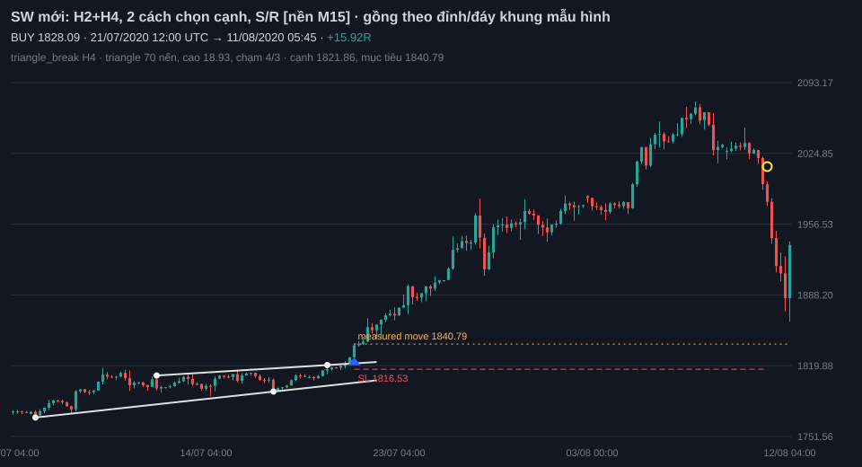
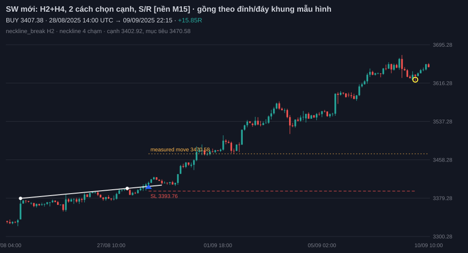
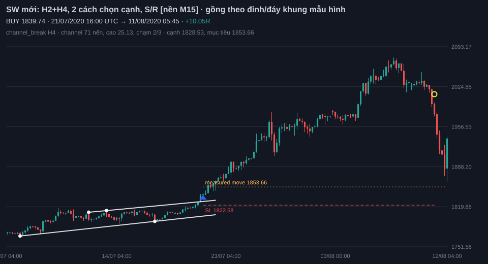
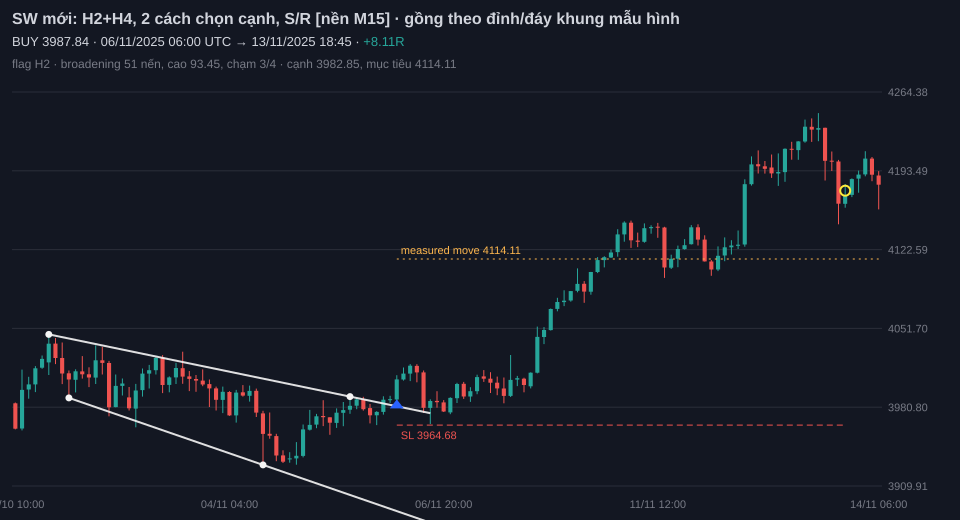
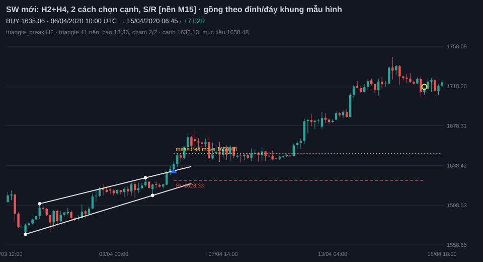
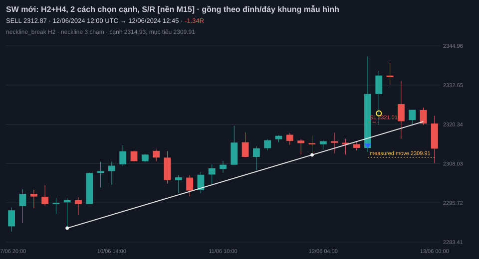
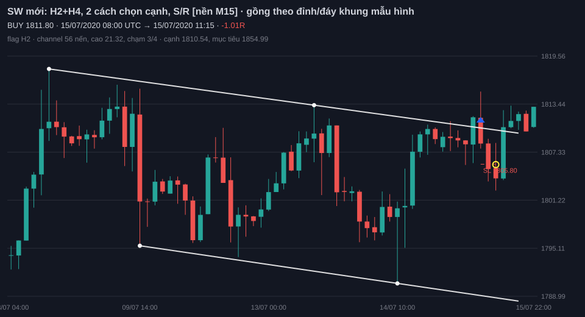

# Bot swing — backtest 2020-01 → 2026-11 (nến M15, đơn vị R, không lãi kép)

Phương pháp mới (đang chạy live từ 2026-11-25): mẫu hình H2 + H4, quét cạnh theo 2 cách (nhiều điểm chạm nhất + điểm neo
mới nhất, râu được xuyên cạnh tới 1 ATR), lọc vùng S/R W1 + D1, gồng SL theo đỉnh/đáy khung mẫu hình, rủi ro tính bằng R.

## So sánh các phiên bản swing

| Phiên bản | Lệnh | Thắng | R/lệnh | Tổng R | DD (R) | 2020 | 2021 | 2022 | 2023 | 2024 | 2025 | 2026 |
|---|---|---|---|---|---|---|---|---|---|---|---|---|
| **Mới**: H2+H4, 2 cách chọn cạnh, S/R | 257 | 30% | +0.35 | +90.5 | 56.9 | +39 | −20 | −16 | −0 | +14 | +57 | +16 |
| H2+H4, cạnh mới nhất, S/R | 294 | 33% | +0.47 | +137.3 | 50.9 | +51 | −18 | −8 | +0 | +24 | +67 | +20 |
| H4, cạnh mới nhất, S/R | 86 | 27% | −0.09 | −7.7 | 38.1 | +3 | −8 | −9 | −4 | +3 | +6 | 0 |
| **H4 gốc** (không S/R) | 174 | 33% | **+0.80** | **+139.3** | **31.6** | +72 | −8 | −6 | −3 | +11 | +61 | +13 |

Ở mức 10% vốn/lệnh lãi kép, phương pháp mới cháy tài khoản trong 2021–2022 (DD 99.8%) → không dùng được với rủi ro đó.

## Lệnh nổi bật (chart do bot vẽ)

Trắng: cạnh mẫu hình (chấm = điểm neo) · tam giác xanh: điểm vào · đỏ đứt: SL ban đầu · cam chấm: mục tiêu measured move ·
vòng vàng: điểm thoát.

**Phá tam giác H4 — BUY 21/07/2020, +15.9R**

**Thủng neckline H2 (4 chạm) — BUY 28/08/2025, +15.9R**

**Phá kênh H4 — BUY 21/07/2020, +10.1R**

**Cờ H2 — BUY 06/11/2025, +8.1R**

**Phá tam giác H2 — BUY 06/04/2020, +7.0R**

**Lệnh thua — thủng neckline H2 SELL 12/06/2024, −1.34R** (giá quay lại ngay, trượt giá qua SL)

**Lệnh thua — cờ H2 BUY 15/07/2020, −1.0R** (phá giả, quay lại trong cờ)

